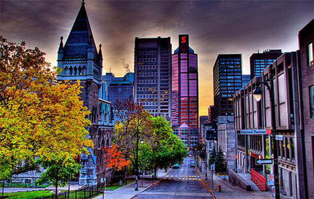
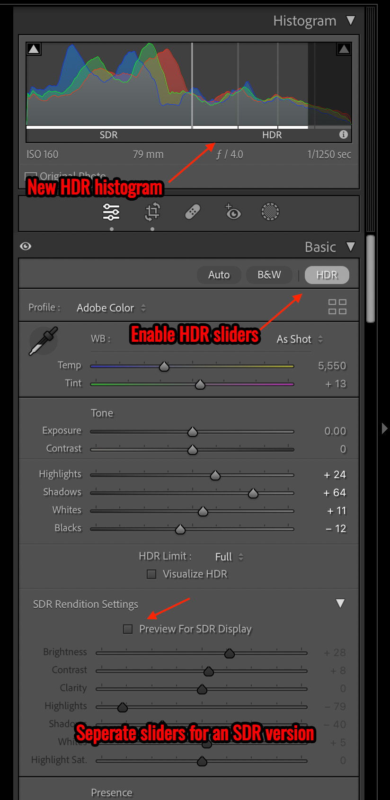
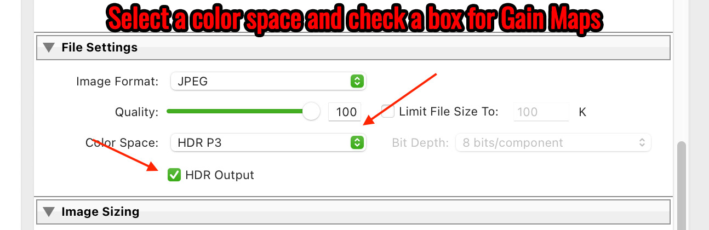
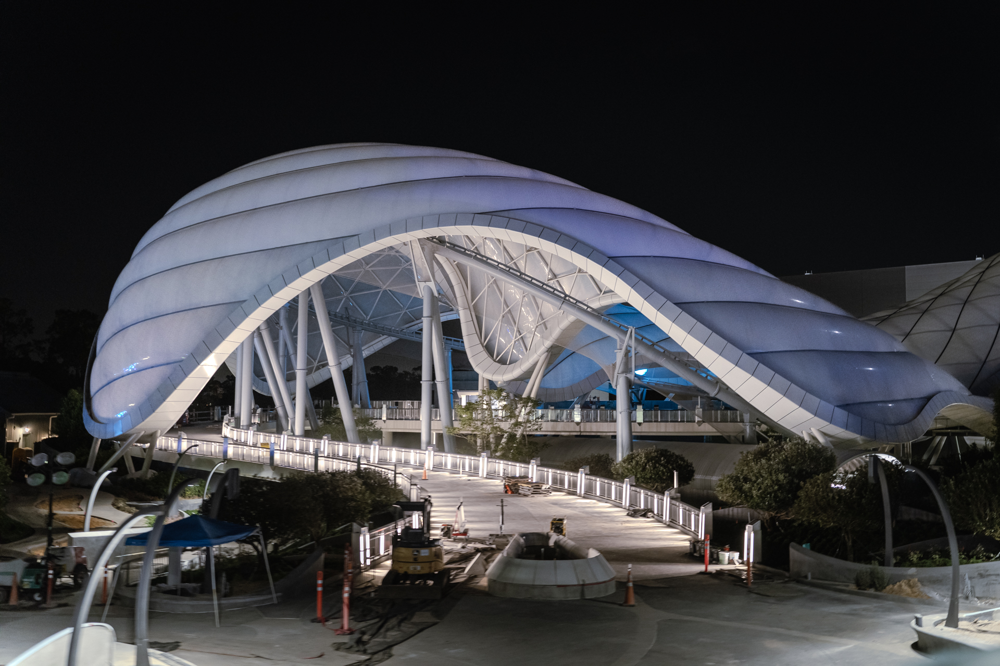

High Dynamic Range (HDR) photos display a wider range of brightness, contrast, and color than Standard Dynamic Range (SDR). On an HDR-capable screen, that difference is visible: brighter highlights, more detail in shadows, and colors that more closely match what the camera actually captured.

Before we go any further, here's what _your_ screen can show:

<div data-demo="screen"></div>

Three green checks means the photos in this post will glow. Anything else, and you'll see the SDR version of each one. (Got a second monitor? Drag this window over to it. The check updates.)

## See it for yourself

The glow is the whole point, so let's start there. Drag across the photo to wipe between the SDR and HDR versions. Both are JPGs exported from the same RAW file, and the HDR one carries a gain map:

<div data-demo="wipe"></div>

The SDR side looks fine until you see the HDR side next to it. Then it looks like someone left a gray filter on the lens.

**If both sides look the same, your browser or display can't show HDR.** The screen check above says which one. The SDR fallback lives in the same file, so you're still seeing a correct version of the photo.

The rest of this post is how one file pulls that off.

## A brief history

For many years there have been two other types of "HDR" in photography. The over-the-top saturated photos from 2012:

<figure>
  
  <figcaption>
  An oversaturated and overly darkened "HDR" image from 2012
  </figcaption>
</figure>

To modern photos captured via [exposure bracketing](https://helpx.adobe.com/lightroom-classic/help/hdr-photo-merge.html) and merged using a technique called [HDR photo merge](https://helpx.adobe.com/lightroom-classic/help/hdr-photo-merge.html):

<figure className="alignwide">
  
  <figcaption>
    An exposure bracketed "HDR" image merged using Adobe Lightroom. This image is still only SDR!
  </figcaption>
</figure>

This post is not about those HDR pretenders though, because at the end of the day: **those two photos only have 8 bits worth of data and are in the sRGB colorspace**.

This post is about _true_ High Dynamic Range photos, which are in a larger colorspace and are shown at a much higher luminance.

## The need for more nits and bits

Most images on the web only contain 8 bits worth of information and are in the sRGB color space. That's strictly a technical limitation of older web-based image formats like .jpg. But did you know that cameras have been capturing RAW photos with more than 8 bits (and in larger colorspace) going back 20+ years?! The extra data was there, but it was essentially invisible to photographers and viewers alike.

How much bigger is a "larger colorspace"? The horseshoe below is every color a person can see. Each triangle is a color space: a screen set to that space can show the colors inside it. Pick one:

<div data-demo="gamut"></div>

sRGB, the space nearly every JPG on the web uses, covers about a third of what you can see. Display P3 goes further into greens and reds, and Rec. 2020 goes further still. The colors outside the triangle aren't wrong. They're just the ones that space has no numbers for.

The problem was that there was no practical way to work with those extra bits or view them on a display. So .jpg and PNG images simply discard everything extra to maximize compression, back when most internet traffic moved over copper.

Today, HDR-capable displays are everywhere: smartphones, tablets, TVs, laptops, and monitors. Most of them cover nearly all of Display P3, a few reach into Rec. 2020, and they hit peak brightness levels that SDR displays cannot match. Newer image formats like AVIF and JPEG XL can hold more bits and retain quality through modern compression.

For reference: the [iPhone 18 Pro](https://www.apple.com/iphone-18-pro/specs/) reaches 1,600 nits for HDR and 3,000 nits outdoors. Current MacBook Pros reach 1,600 nits for HDR content. A typical budget office monitor tops out around 250.

Even with that hardware in place and the extra data already present in RAW files, the missing link has been a photo editor capable of editing in true HDR.

## What are gain maps?

A gain map is a matrix of values applied to an image that multiplies pixel brightness independently across different areas. This lets a single image file carry two versions: a full HDR rendition and a standard SDR fallback. If a viewer's browser and display support HDR, they see the HDR version. If not, the browser shows the SDR version automatically.

Apple, Google, and Adobe each started with their own flavor. In July 2025 they became one standard, [ISO 21496-1](https://www.iso.org/standard/86775.html), and Chrome, Android 15, iOS 18, and macOS 15 all read it.

Because both versions live in one file, you export once and get coverage across HDR and SDR displays without managing separate files. As HDR display support expands, your existing exports are already ready for it.

Here's the clever part: it isn't all or nothing. Every HDR screen has some amount of _headroom_, which is how many times brighter than white it can go right now. That number moves with your brightness setting and the room you're in. The browser scales the gain map to fit whatever headroom the screen has.

This is real data: one row of pixels across the Hollywood Blvd photo, right through the marquee lights, with its gain map applied the way the [spec](https://helpx.adobe.com/camera-raw/using/gain-map.html) says to. The line marked White is as bright as an SDR screen gets. Drag the slider:

<div data-demo="headroom"></div>

At 1x, every bulb flattens out at white, because that's the SDR photo. Turn it up and the screen limit rises, the bulbs climb past white, and the shadows stay put. The gain map only boosts what was bright in the scene, and only as far as your screen can go.

> [!NOTE] Where do the nits come from?
> SDR white on an HDR screen is 203 nits, per the ITU's [BT.2408](https://www.itu.int/pub/R-REP-BT.2408) report. Multiply that by the headroom and you get the brightest pixel the screen will show. A MacBook Pro's 1,600 nits works out to about 8x.

## Why can't CSS just glow?

Confession: the glow in that chart is fake. I drew it. The photos on this page can go brighter than white, but the page around them can't.

Every color CSS can name tops out at the page's white. `#fff`, `rgb(255 255 255)`, and `color(display-p3 1 1 1)` all land on the same brightness. Display P3 gets you redder reds and greener greens, not a brighter white. The W3C says so in the [CSS Color HDR module](https://www.w3.org/TR/css-color-hdr-1/): the color spaces in CSS Color 4 are, "By design, these are all Standard Dynamic Range (SDR) color spaces."

That same HDR module is the fix. It adds HDR color spaces like `rec2100-pq` and `rec2100-hlg`, with diffuse white at 203 nits (the same number from BT.2408). It's still a Working Draft, though; the latest is from October 2026. I asked my copy of Chrome 155, and `CSS.supports('color', 'color(rec2100-pq 1 1 1)')` came back `false`.

One piece has shipped: `dynamic-range-limit`, in Chrome 136 and Safari 26 ([caniuse](https://caniuse.com/mdn-css_properties_dynamic-range-limit)). It goes the other direction. It turns HDR _down_, so a grid of thumbnails doesn't light up your face:

```css
/* Thumbnails stay at SDR white; the full-size photo gets the whole screen */
.thumbnail {
  dynamic-range-limit: standard;
}
```

So for now, the only things on a web page that can get brighter than white are images and video. That's why gain maps live in the image file.

## Adobe Lightroom support

In October 2022, Adobe [released a technology preview](https://helpx.adobe.com/camera-raw/using/whats-new/2023.html) of High Dynamic Range Output in Adobe Camera Raw. It let photographers experiment with exporting images above 8-bit and viewing them on HDR displays, but the workflow was cumbersome and browser support was limited.

In October 2023, Adobe [released a new version of Lightroom Classic](https://helpx.adobe.com/lightroom-classic/help/whats-new/2024.html) with full support for [editing and exporting HDR](https://helpx.adobe.com/camera-raw/using/hdr-output.html) photos. That filled the gap.

The new HDR workflow in Lightroom adds HDR-specific sliders to the editing panel:

<figure style="max-width: 420px; margin: 0 auto;">
  
  <figcaption>
    A screenshot of Adobe Lightroom Classic's new HDR histogram and sliders
  </figcaption>
</figure>

At export, you can select a color space and toggle HDR Output to include a Gain Map:

<figure>
  
  <figcaption>
    A screenshot of Adobe Lightroom's new HDR export options, including Gain
    Maps and color space choices.
  </figcaption>
</figure>

You can use this workflow on most any RAW photo dating back 20+ years, and the HDR sliders will adjust the Gain Map values to reflect your edits giving new life to old photos.

JPG isn't the only option, either. Lightroom can put the same gain map in an AVIF. For Remy's studio, the HDR AVIF came out at 2.3 MB, against 3.8 MB for the HDR JPG. That's 39% smaller for the same photo. The catch: Chrome still shows AVIF gain maps only behind a flag, so for the web, JPG is the safe bet.

## Too much of a good thing

The HDR highlights and whites sliders are easy to overdo. This shot from Indiana Jones Epic Stunt Spectacular shows what happens when you push them too far. SDR source:


HDR export, with the sliders maxed out:

<figure className="alignwide">
  
  <figcaption>
    An explosion during Indiana Jones Epic Stunt Spectacular. HDR (JPG) | Sony
    a7R IVA | Tamron 35-150mm | 1/1250 sec, f/4, ISO 160
  </figcaption>
</figure>

The result looks processed and artificial, which puts it closer to the 2012-era HDR photos than anything you'd want to publish. Treat the HDR sliders the same way you would exposure or contrast: use enough to reflect what you saw, not to demonstrate that the sliders exist.

## But can I print in HDR?

No. This is a physical limitation, not a technical one. Photo paper cannot increase its own brightness the way an HDR display can boost individual pixels.

## Browser, app, and CMS support

Software support is still catching up to hardware. Here's where things stand in October 2026:

**Photo editors and apps**

- Adobe Photoshop, Lightroom, and Camera Raw: [full support](https://blog.adobe.com/en/publish/2023/10/10/hdr-explained) for editing and exporting gain maps in P3 and Rec. 2020
- Affinity Photo: edits in 32-bit HDR, but can't export gain maps
- Apple Photos: shows ISO and Apple gain maps on iOS 18, iPadOS 18, and macOS 15 and later
- Google Photos: shows and edits Ultra HDR JPGs

**Image formats**

- JPG: best browser support
- AVIF: smaller files, but Chrome shows AVIF gain maps only behind a flag
- HEIF: Safari only
- JPEG XL: Safari supports it, and Chrome 155 [brings it back](https://developer.chrome.com/blog/jpeg-xl-in-chrome) after dropping it in 2022

**Web browsers**

- Chrome, Edge, Brave, and Opera: full support for JPG gain maps since Chrome 116 (2023)
- Safari: full support since Safari 26, on macOS, iOS, and iPadOS
- Firefox: no HDR photos yet on desktop or Android. Firefox 153 added HDR video on Windows, and there's an [open request](https://connect.mozilla.org/t5/ideas/support-iso-21496-1-the-hdr-over-jpg-standard-via-gain-map-with/idi-p/77844) for gain maps. (Firefox on iPhone uses Safari's engine, so it works there.)

**Social media**

- Instagram and Threads: HDR photos in posts, but not Stories
- Facebook: HDR video only

**Content management systems**

- WordPress: [7.1 keeps gain maps](https://make.wordpress.org/core/2026/07/22/client-side-media-processing-in-wordpress-7-1/) on upload, thumbnails included

**HDR-capable displays**

- 14- and 16-inch MacBook Pro (2021 and later)
- iPhone, iPad, Samsung Galaxy, Google Pixel
- Apple Pro Display XDR
- TVs and monitors supporting HDR10, HDR10+, HLG, or Dolby Vision

## Where I landed

<figure className="alignwide">
  
  <figcaption>
    Tron Lightcycle Run at Magic Kingdom in HDR (JPG) | Sony a7R IVA | Tamron
    35-150mm | 1/40 sec, f/2, ISO 2500
  </figcaption>
</figure>

I'll be using Lightroom's HDR workflow going forward. If you're shooting RAW, the data is already there. You just need the export pipeline to do something with it.

## Want to go deeper?

Adobe's [Lightroom HDR documentation](https://helpx.adobe.com/lightroom-classic/help/hdr-output.html) covers the export workflow in detail. For the full technical spec, see Adobe's [Gain Map specification](https://helpx.adobe.com/camera-raw/using/gain-map.html). Greg Benz has written an in-depth breakdown of [JPG HDR Gain Maps in Camera Raw](https://gregbenzphotography.com/hdr-images/jpg-hdr-gain-maps-in-adobe-camera-raw/), a solid [HDR overview](https://gregbenzphotography.com/hdr/), and an [HDR example gallery](https://gregbenzphotography.com/hdr-gain-map-gallery/) worth browsing.
