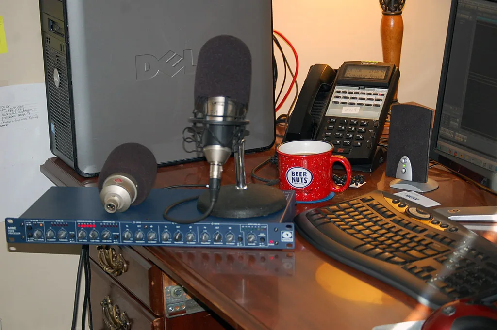
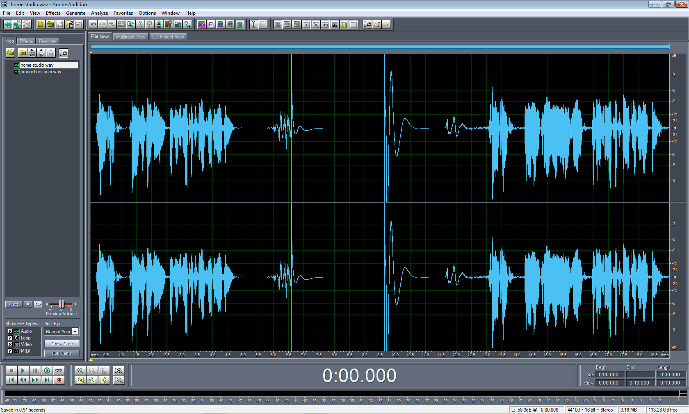
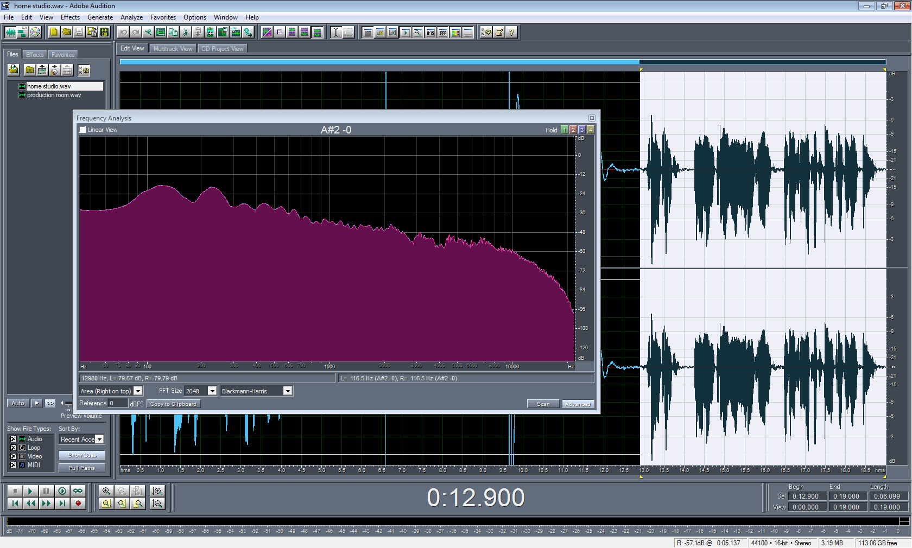
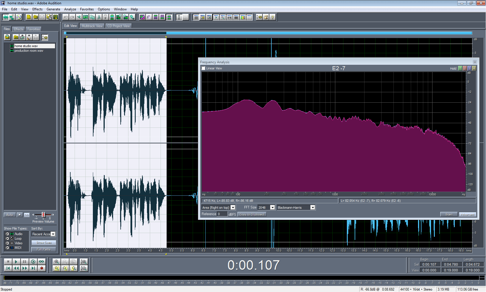
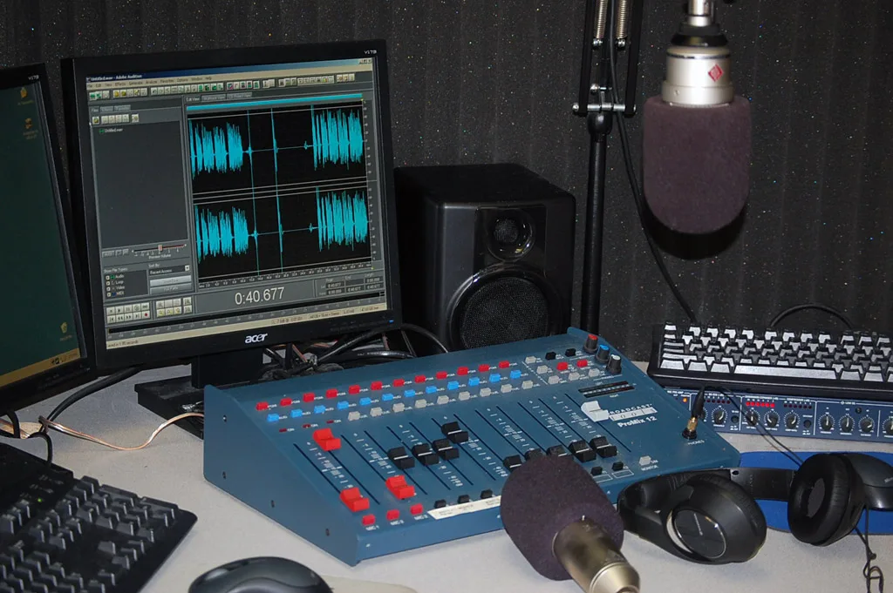
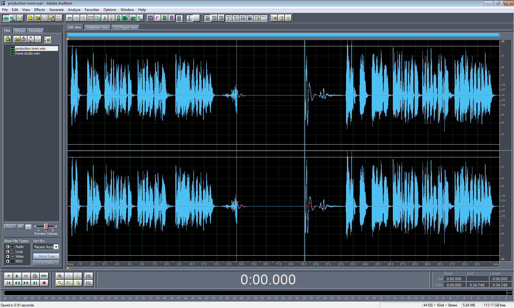
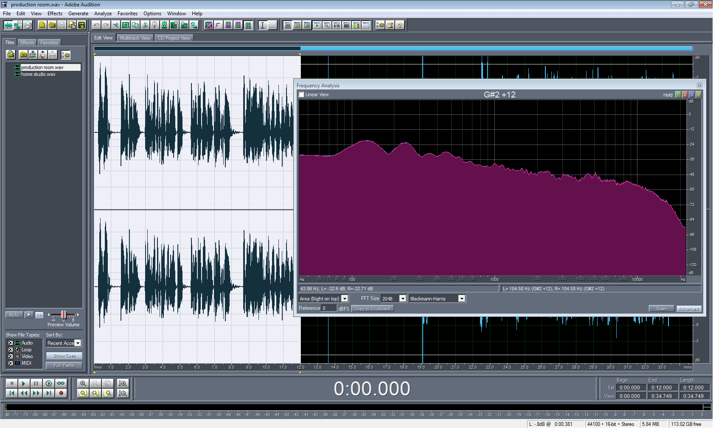
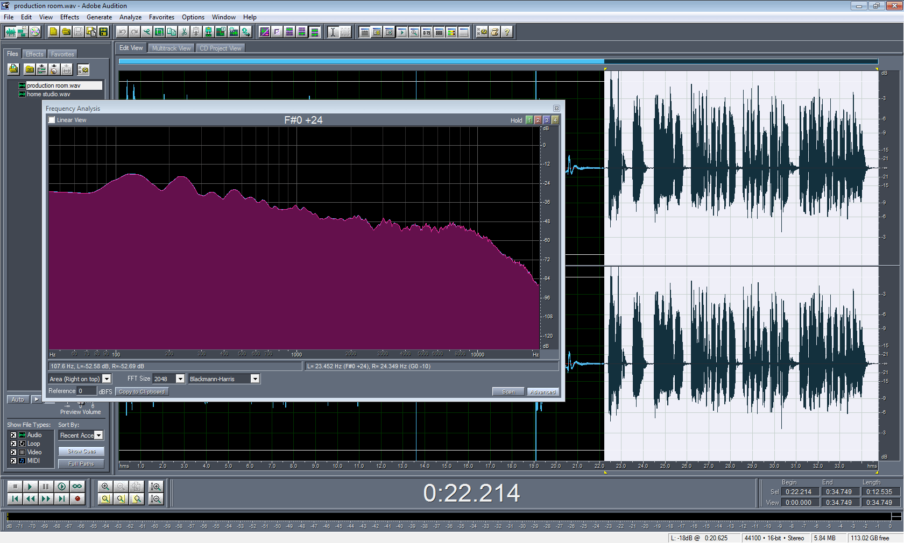

I'm a 15-year radio veteran. I've seen the debate between high-end and low-end microphones both in person and on internet message boards. Usually, the argument ends with a snide remark like: _"The Behringer is garbage because it's only $100 bucks!"_ That's not very scientific, so I wanted to study this on a technical level.

> [!NOTE] Updated November 2026
> Short version, if you're shopping: a [Behringer B-1](https://www.amazon.com/dp/B0DV5QTVT9?linkCode=ll2&tag=gregrick0f-20&linkId=79c4d35308206f5c38041de58a5cdaf5&language=en_US&gaOptInStatus=true&ref_=as_li_ss_tl) (about $100) and a USB audio interface like the [Behringer UMC202HD](https://www.amazon.com/Behringer-UMC202HD-BEHRINGER-U-PHORIA-2-Channel/dp/B00QHURUBE?linkCode=ll2&tag=gregrick0f-20&linkId=0e9f5462fed8e287bdfa01f34ea1733a&language=en_US&gaOptInStatus=true&ref_=as_li_ss_tl) (about $90) make a voice-over rig for under $200. Starting a podcast? A USB mic like the [RØDE PodMic USB](https://www.amazon.com/Broadcast-Microphone-broadcast-all-metal-interface/dp/B0BQM4TKF7?th=1&linkCode=ll2&tag=gregrick0f-20&linkId=f464ec7799e30580a826d9a2bd47b3f3&language=en_US&gaOptInStatus=true&ref_=as_li_ss_tl) plugs straight into your computer. Save the [Neumann TLM 103](https://www.amazon.com/Neumann-TLM-103-Condensor-Microphone/dp/B00AAO3FQ2?linkCode=ll2&tag=gregrick0f-20&linkId=988878e934ee9134868a3d9b76f8d808&language=en_US&gaOptInStatus=true&ref_=as_li_ss_tl) (about $1,300) for when voice work pays the bills. The [buying checklist](#buying-checklist-for-2026) and [podcasting section](#podcasting-with-a-usb-mic) at the bottom have the details.

In my office is a [Behringer B-1](https://www.amazon.com/dp/B0DV5QTVT9?linkCode=ll2&tag=gregrick0f-20&linkId=79c4d35308206f5c38041de58a5cdaf5&language=en_US&gaOptInStatus=true&ref_=as_li_ss_tl) that I purchased new in 2001. It's widely known as a cheap, yet rugged starter microphone. I've used it to voice-track, cut voice-overs, and mic live instruments (the coolest being a 100-year-old cello). It's a tough microphone and still going strong 25 years later! It really is a microphone you can toss into the backseat on the way to a gig and not think twice.

The [Neumann TLM 103](https://www.amazon.com/Neumann-TLM-103-Condensor-Microphone/dp/B00AAO3FQ2?linkCode=ll2&tag=gregrick0f-20&linkId=988878e934ee9134868a3d9b76f8d808&language=en_US&gaOptInStatus=true&ref_=as_li_ss_tl) is known as a high-end, yet affordable option for voice-over professionals. The Neumann name is known throughout the recording industry as _THE_ microphone for vocals. It's truly the Cadillac! There are three TLM 103s in the building, one in each production room. Many of our DJs have them in their home studios too.

What you're about to see (and hear) is me talking into both microphones, _unedited_. To prove that I'm not swapping voice processors, you'll even hear me changing out the microphones. I personally have no stake in the argument, I'm an engineer. I simply wanted to introduce a more technical and practical point of view.

## Technical specifications

I grabbed the following specifications from each respective website.

### Behringer B-1 specs

- Type: Condenser, FET, transformerless
- Capsule: 1-inch gold-sputtered large diaphragm
- Pickup pattern: Cardioid
- Frequency response: 20 Hz to 20 kHz
- Sensitivity: 20 mV/Pa
- Max SPL: 135 dB (148 dB with the pad)
- Switches: -10 dB pad, 75 Hz low cut
- Power: 48 V phantom
- Official Site: [Behringer](https://www.behringer.com/en/products/0504-AAB))

### Neumann TLM 103 specs

- Type: Condenser, transformerless
- Capsule: Large diaphragm, derived from the U 87's K 87 capsule
- Pickup pattern: Cardioid
- Frequency response: 20 Hz to 20 kHz
- Sensitivity: 23 mV/Pa
- Self-noise: 7 dB-A
- Max SPL: 138 dB
- Switches: None
- Power: 48 V phantom
- Official Site: [Neumann](https://www.neumann.com/en-us/products/microphones/tlm-103))

Would you look at that? On paper, they're nearly the same microphone: same pattern, same range, and within 3 dB on sensitivity and max SPL. The number that matters is self-noise. Neumann publishes 7 dB-A, which is about as quiet as a microphone gets. Behringer doesn't list one on the B-1's page. With a voice a few inches from the grille you won't hear the difference, but on a quiet acoustic guitar or a soft-spoken read, you might.

## Test 1: Basic home studio

With this test, I'm recreating a (very) basic home studio. There's no audio board, just the voice processor plugged into "Line-In" on the motherboard sound card. For both tests, the B-1 is set to "flat" as there is no low-frequency roll-off option on the TLM 103.

Equipment:

- Symetrix 528e Voice Processor
- On-Board High Definition Audio Card (Dell Optiplex 360)

Here's the recording in Adobe Audition:

### Home studio frequency response

### Home studio audio

The B-1 comes first, then the swap, then the TLM 103.

<audio controls>
  <source src="./B1-vs-TLM-103-home-studio1.mp3" type="audio/mpeg">
</audio>

## Test 2: Production room

Now, let's move into a real-live-working production room at a radio station. This room is "Prod 3". It is used daily to voice-track shows and cut commercials. It features a flat-response 12-channel mixer, and a professional-grade sound card. Oh, and lots of foam on the walls.

_Note: I used the same exact voice processor in each test._

Equipment:

- Symetrix 528e Voice Processor
- Broadcast Tools ProMix 12
- Audio Science 4344 Sound Card

Here's the recording in Adobe Audition:

### Production room frequency response

### Production room audio

Same order: B-1, swap, TLM 103.

<audio controls>
  <source src="./B1-vs-TLM-103-production-room1.mp3" type="audio/mpeg">
</audio>

## Which one sounds better?

It's obvious the production room environment _sounds_ better. That has nothing to do with the board, and everything to do with the professional sound card and a room with plenty of acoustic foam.

IMHO: The [B-1](https://www.amazon.com/dp/B0DV5QTVT9?linkCode=ll2&tag=gregrick0f-20&linkId=79c4d35308206f5c38041de58a5cdaf5&language=en_US&gaOptInStatus=true&ref_=as_li_ss_tl) sounds brighter and a bit "punchy", while the [TLM 103](https://www.amazon.com/Neumann-TLM-103-Condensor-Microphone/dp/B00AAO3FQ2?linkCode=ll2&tag=gregrick0f-20&linkId=988878e934ee9134868a3d9b76f8d808&language=en_US&gaOptInStatus=true&ref_=as_li_ss_tl) sounds warm and more "mellow". Overall, they're not that far apart. (Really.) Their frequency response graphs are nearly identical.

How? Quality of materials and parts used in construction.

What does that mean? Nothing. A Pop DJ might want to sound punchy, while a soft-rock DJ will want to sound warmer. Do you want to troll the name "Neumann" to owners of B-1s on the Internet? Or do you want to have a fantastic-sounding microphone for about $100? In the end, it's all about your budget and application.

A co-worker of mine, John Garrett, does voice-overs for a living. He started out with a [Behringer B-1](https://www.amazon.com/dp/B0DV5QTVT9?linkCode=ll2&tag=gregrick0f-20&linkId=79c4d35308206f5c38041de58a5cdaf5&language=en_US&gaOptInStatus=true&ref_=as_li_ss_tl). He jokes about how that "starter microphone" made him a living for a few years. (later he purchased a [TLM 103](https://www.amazon.com/Neumann-TLM-103-Condensor-Microphone/dp/B00AAO3FQ2?linkCode=ll2&tag=gregrick0f-20&linkId=988878e934ee9134868a3d9b76f8d808&language=en_US&gaOptInStatus=true&ref_=as_li_ss_tl).)

John Garrett's and my advice:

- Don't worry about the microphone as much as the gear surrounding it.
- Buy a good audio interface. It will make your audio sound better long before you hook up the microphone.
- Use sound-dampening foam in your studio or room.

## Buying checklist for 2026

John and I still stand by that advice. What's changed is the gear. In 2013, "a good sound card" meant a PCI card and a rack of gear. Today it's a USB box the size of a sandwich. If I had to start over, here's what I'd put in my office:

- Start with a [Behringer UMC202HD](https://www.amazon.com/Behringer-UMC202HD-BEHRINGER-U-PHORIA-2-Channel/dp/B00QHURUBE?linkCode=ll2&tag=gregrick0f-20&linkId=0e9f5462fed8e287bdfa01f34ea1733a&language=en_US&gaOptInStatus=true&ref_=as_li_ss_tl). About $90, two mic inputs with phantom power, and it plugs into USB. Add a B-1 and you have a voice-over rig for under $200.
- Treat the room before you upgrade the mic. Foam, a closet full of clothes, or a moving blanket behind you. A condenser hears your room as clearly as your voice.
- Recording in a loud or untreated room? Look at a dynamic mic. The [Shure SM7B](https://www.amazon.com/Shure-SM7B-Cardioid-Dynamic-Microphone/dp/B0002E4Z8M?th=1&linkCode=ll2&tag=gregrick0f-20&linkId=6a124efefbc818cca8c8ef324b9c5d98&language=en_US&gaOptInStatus=true&ref_=as_li_ss_tl) hears far less of the room than either condenser here. It needs a lot of gain, so pair it with an interface that has plenty.
- Want the radio sound in one box? A channel strip like the [dbx 286s](https://www.amazon.com/dbx-286s-Microphone-Channel-Processor/dp/B004LWH79A?linkCode=ll2&tag=gregrick0f-20&linkId=8afb36db87780f17d9f55c9a6bb23172&language=en_US&gaOptInStatus=true&ref_=as_li_ss_tl) adds a preamp, compressor, and de-esser. The [Symetrix 528e](https://www.amazon.com/Symetrix-528E-Voice-Processor/dp/B0006HBP2O?linkCode=ll2&tag=gregrick0f-20&linkId=7711ead3c3cd2c1a3e8a2b6981f3d517&language=en_US&gaOptInStatus=true&ref_=as_li_ss_tl) from these tests is still around too.
- Buy the [TLM 103](https://www.amazon.com/Neumann-TLM-103-Condensor-Microphone/dp/B00AAO3FQ2?linkCode=ll2&tag=gregrick0f-20&linkId=988878e934ee9134868a3d9b76f8d808&language=en_US&gaOptInStatus=true&ref_=as_li_ss_tl) when the mic is the last weak link. If clients are paying you and the room is already quiet, take the leap. Just don't expect gigs to flood in because you own a $1,300 microphone.

## Podcasting with a USB mic

When I ran these tests in 2013, podcasting was just becoming a big deal. Today it seems like everyone has a podcast, and most of them don't want a rack of gear. They want one cable.

That's the [RØDE PodMic USB](https://www.amazon.com/Broadcast-Microphone-broadcast-all-metal-interface/dp/B0BQM4TKF7?th=1&linkCode=ll2&tag=gregrick0f-20&linkId=f464ec7799e30580a826d9a2bd47b3f3&language=en_US&gaOptInStatus=true&ref_=as_li_ss_tl). It's a dynamic mic like the SM7B, so it hears your voice and not much of your room. Plug it in over USB-C and the preamp, compressor, noise gate, and high-pass filter all run inside the mic. That's the same job the Symetrix 528e did in these tests, minus the rack. There's a headphone jack for hearing yourself with no delay, and an XLR jack for the day you outgrow USB and move to an interface.

Want the real radio sound? Walk into almost any on-air studio and you'll find an [Electro-Voice RE20](https://www.amazon.com/Electro-Voice-RE20-BLACK-Broadcast-Microphone-RE20/dp/B08P7QTZM5?th=1&linkCode=ll2&tag=gregrick0f-20&linkId=3264f7c75cb71dfc7a87426bd1190650&language=en_US&gaOptInStatus=true&ref_=as_li_ss_tl) on the boom arm. It's been the radio industry standard for decades. It's XLR only and needs plenty of gain, so pair it with a good interface or a channel strip like the dbx 286s.

And if someone on a message board tells you your mic is garbage because it only cost $100? Send them the clips.

## Affiliate disclaimer

The Amazon links in this post are affiliate links. **As an Amazon Associate I earn from qualifying purchases**, at no extra cost to you. It helps pay for the site, and a commission never changes what I write.
